<a href="https://dgkim0996-crypto.github.io">
  <picture>
    <source media="(prefers-color-scheme: dark)" srcset="./assets/banner-dark.svg">
    
  </picture>
</a>

  
  

## 🛠️ 기술 스택

<table>
  <tr><td><b>AI · ML</b></td><td> &nbsp;Claude API, OpenAI API, Whisper</td></tr>
  <tr><td><b>Backend</b></td><td> &nbsp;WebSocket</td></tr>
  <tr><td><b>Frontend</b></td><td></td></tr>
  <tr><td><b>Database</b></td><td></td></tr>
  <tr><td><b>Desktop</b></td><td> &nbsp;WinForms, Chrome Extension</td></tr>
  <tr><td><b>Infra · CI/CD</b></td><td></td></tr>
  <tr><td><b>Test</b></td><td> &nbsp;pytest</td></tr>
  <tr><td><b>Tools</b></td><td></td></tr>
</table>

## 💼 프로젝트

| | 이름 | 구분 | 기간 | 코드 |
|:-:|:--|:--|:--|:-:|
|  | [한솥밥](https://dgkim0996-crypto.github.io/#hansotbap) | POSCO K-뉴딜 아카데미 해커톤 5인·**대상(1위)**, 고로 3D·화면·AI와 규칙 비교 실험 | 2026.11 | [GitHub](https://github.com/posco-hackathon/hansotbap) |
|  | [FantaSteel ERP](https://dgkim0996-crypto.github.io/#fantasteel) | 포스코 K-뉴딜 아카데미 팀 5인·본선 2위, 수주·재고 API·화면 도우미 | 2026.09 – 2026.10 | [GitHub](https://github.com/SteelFlowLLM/fantasteel-erp) |
|  | [OPIc AI 채점 시뮬레이터](https://dgkim0996-crypto.github.io/#opic) | 개인 프로젝트, 규칙 루브릭 + ML 채점·모델 관문 | 2026.10 – 2026.11 | 비공개 |
|  | [포스코증권 모의투자](https://dgkim0996-crypto.github.io/#stock) | 개인 프로젝트, 실시간 시세·멱등 주문 | 2026.09 – 2026.10 | [GitHub](https://github.com/dgkim0996-crypto/posco-stock) |
|  | [은행 모드 BankMode](https://dgkim0996-crypto.github.io/#bankmode) | 개인 프로젝트, Windows 앱 + Chrome 확장 공개 배포 | 2026.10 | [GitHub](https://github.com/dgkim0996-crypto/bank-plugin) |

이름을 누르면 포트폴리오 사이트에서 문제와 해결 과정을 볼 수 있어요.

## 📊 활동

  

## 🌱 지금 하는 것

- 🎓 포스코 K-뉴딜 아카데미 LLM 과정 수강 중 (2026.07부터, 576시간)
- 📝 프로젝트마다 문제와 해결 과정을 [포트폴리오 사이트](https://dgkim0996-crypto.github.io)에 정리하고 있어요

README 구성과 배너는 함께 해커톤을 한 [정건희](https://github.com/donasman)의 프로필을 바탕으로 했습니다. 배너는 <code>python banner/build_svg.py</code>로 다시 만들 수 있습니다.
